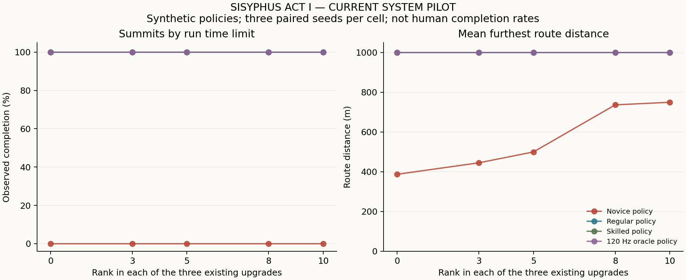

# SISYPHUS 1막 — 현재 구현 난이도와 성장 분석

분석 기준: `099c5915f6df4151bed4a6fecf88ba39f18a098b`, Godot 4.5.1 stable, 생성 세대 6. 2026-10-26.

**현재 구현된 레벨업·쉼터 강화만 실험했다. 게임의 물리·성장·UI·저장 코드와 지형 리소스는 변경하지 않았다.** 석판·EXP 직접 소비·세피로트·프레스티지는 최종 도구와 분석에서 제외했다. 아래 결과는 설정된 자동 입력 정책의 결과이며 실제 인간의 완주율·학습 속도가 아니다.

## A. 현재 게임 진단

현재 무강화 완주는 물리 오류나 공짜 추진력을 이용해야 가능한 상황이 아니다. 일반·숙련 정책은 세 시드 모두 약 10.3분에 완주했다. 초보 정책은 모든 능력이 최대 20% 강화되어도 세 시드 모두 추락했다. 이 예비 실험에서는 **성장 수준보다 입력 정책의 차이가 결과를 더 크게 나눴다.**

### 실측한 성장 효과

각 셀은 같은 산 시드 101·202·303을 사용한 3회 실행이다. 자연 날씨는 각각 비·맑음·맑음이다. 단일 등반의 강화 수치는 실험용 초기 조건으로 고정했고 도중에 구매하지 않았다. 실제 레벨업은 별도의 반복 도전 실험에서만 적용했다.

| 정책 | 무강화 정상 도달 | 무강화 평균 최고 거리 | 무강화 평균 완주 시간¹ | 모든 능력 10회 강화 정상 도달 | 최대 강화 평균 최고 거리 | 최대 강화 평균 완주 시간¹ |
|---|---:|---:|---:|---:|---:|---:|
| 초보 | 0/3 | 387.4m | — | 0/3 | 749.6m | — |
| 일반 | 3/3 | 1,000m | 617.8초 | 3/3 | 1,000m | 610.6초 |
| 숙련 | 3/3 | 1,000m | 619.3초 | 3/3 | 1,000m | 615.2초 |
| 120Hz 정밀 제어 | 3/3 | 1,000m | 915.9초 | 3/3 | 1,000m | 913.2초 |

¹ 완주한 표본에 한정한 시간이다. 미완주에 가상의 완주 시간을 부여하지 않았다. 3/3의 Wilson 95% 구간은 약 43.9~100%, 0/3은 0~56.1%로 넓다. 적은 표본에서 100%라는 숫자를 일반적인 보장으로 해석하면 안 된다.

| 정책별 평균 최고 거리 | 각 0회 | 각 3회(+6%) | 각 5회(+10%) | 각 8회(+16%) | 각 10회(+20%) |
|---|---:|---:|---:|---:|---:|
| 초보 | 387.4m | 445.3m | 499.9m | 736.7m | 749.6m |
| 일반·숙련·정밀 제어 각각 | 1,000m | 1,000m | 1,000m | 1,000m | 1,000m |

### 무강화 완주가 가능한 구조

1. **이동 중 평지 회복이 반복된다.** 산은 42m 오르막과 8m 평지의 20개 묶음이다. 쉼터는 총 160m이며, 입력을 놓으면 평지에서 이동 중에도 초당 10의 스태미나를 회복한다. 일반 무강화 정책의 평균 쉼터 노출은 145.08초였으나, 실제 정지·입력 해제 휴식은 1.73초였다. 서서 오래 기다리지 않고도 회복할 수 있다.
2. **추진력 증가는 속도 상한에 막힌다.** 전진 상한은 1.8m/s다. 일반 무강화 정책의 오르막 노출 시간은 약 472.73초로, 840m를 상한 속도로 이동하는 466.67초에 가깝다. 모든 능력 +20%의 시간 단축은 일반 1.17%, 숙련 0.67%였다. 최대 스태미나·회복 속도는 부족해지는 상황에서 중요하지만, 이 정책에서는 대체로 병목이 아니었다.
3. **많은 구간에서 Slip이 발동하기 전에 평지에 도달한다.** 예를 들어 35° 돌 지형에서 고속 일반 밀기의 Slip 순증은 초당 1.6이다. 42m를 1.8m/s로 지나가는 동안 약 37만 쌓이고, 평지에서는 초당 20씩 감소한다. 실제 기본·강화 비교에서 일반·숙련·정밀 제어 정책의 Slip과 고갈은 모두 0회였다. 이는 Slip이 작동하지 않는다는 뜻이 아니라, 이 정책들이 발동 조건을 피했다는 뜻이다.
4. **Shift를 계속 누르는 비용은 성장만으로 상쇄되지 않는다.** 초보 정책은 속도 상한 이후에도 Shift를 많이 사용한다. 힘주기의 3배 스태미나 소모, 증가한 Slip, Slip 발생 시 스태미나 8 손실과 0.7초 추진 차단이 이어진다. 평균 Slip은 무강화 2회에서 최대 강화 7.67회로 늘었다. 강화 후 더 멀리 가면서 위험에 노출되는 시간도 늘므로 단순 횟수 증가를 강화의 부작용으로 해석해서는 안 된다.

근거 구현: [돌 물리](../scripts/boulder_controller.gd), [산 생성과 평지](../scripts/mountain_manager.gd), [현재 성장](../scripts/progression.gd). 기본 추진력 2.6, Shift 배율 1.65, 120Hz 적분, 버티기 힘 5.8, 현재 버티기 소모 `4 × 경사 소모 배율/초`, Runaway 기준 -4m/s는 그대로 사용했다.

### 한 능력만 강화한 경우

다른 두 능력을 0회로 고정했다. 표의 시간은 정상 도달한 일반 정책의 평균이며, 초보 열은 미완주 최고 거리 평균이다.

| 강화 | 일반 평균 완주 시간 | 초보 평균 최고 거리 |
|---|---:|---:|
| 무강화 | 617.8초 | 387.4m |
| 밀기 힘 5회(+10%) | 614.3초 | 433.9m |
| 밀기 힘 10회(+20%) | 610.3초 | 386.8m |
| 최대 스태미나 5회(+10%) | 617.8초 | 401.8m |
| 최대 스태미나 10회(+20%) | 617.4초 | 414.2m |
| 회복 속도 5회(+10%) | 617.4초 | 440.1m |
| 회복 속도 10회(+20%) | 617.4초 | 428.4m |

초보의 비단조 결과는 작은 표본, 시간 기준 오류 입력이 발생하는 위치의 변화, 정책의 스태미나 비율·속도 임계값에 영향을 받는다. 따라서 “힘 강화가 해롭다”거나 단일 능력의 우열이 확정됐다고 결론 내릴 수 없다. 중간 단독 강화 3·8회는 100시드 확장 설정에 포함했으며 이번 예비 실행에는 포함하지 않았다.

## B. 최초 정상까지의 시간과 구간별 난이도

### 실제 레벨업을 적용한 반복 도전

시작 seed101에서 추락마다 새 산을 만들고, XP·강화를 유지했다. 아래 각 셀은 **한 캠페인**이므로 전략별 평균이나 인간 집단의 예측으로 해석할 수 없다. 시간은 누적 시뮬레이션 분이다.

| 정책 | 균등 성장 | 추진 중심 | 안정 중심 |
|---|---|---|---|
| 초보 | **100.59분, 18회에 첫 정상** | 175.60분·30회까지 미완주 | 174.75분·30회까지 미완주 |
| 일반 | 10.28분, 1회 | 10.28분, 1회 | 10.39분, 1회 |
| 숙련 | 10.32분, 1회 | 10.29분, 1회 | 10.45분, 1회 |
| 정밀 제어 | 15.30분, 1회 | 15.28분, 1회 | 15.31분, 1회 |

초보·균등 성장의 최초 정상은 누적 3,580XP, 세 능력 각 7회 강화였다. 세 능력 각 3·5·7회를 실제로 갖춘 시각은 각각 26.85·57.24·95.94분이었다. 추진 중심은 6,080XP와 힘10/최대스태미나10/회복9, 안정 중심은 5,990XP와 힘9/최대스태미나10/회복10까지 성장했지만 측정 제한 전에 정상에 도달하지 못했다. 두 미완주 표본에 175분을 '첫 정상 시간'으로 대입하지 않는다.

추진 중심의 세 능력 각 8·9회 도달은 158.57·167.36분, 안정 중심은 159.12·169.01분이었다. 따라서 **자원을 모아 8~9회씩 강화하는 속도와 정상에 도달하는 속도는 같은 문제가 아니다.** 균등 전략이 우월하다고 확정하기에도 한 시작 seed는 부족하다. 고정 정책은 실패 후 조작을 학습하지 않으며, 매 회차 산과 오류가 발생하는 위치도 달라진다.

후속 진단에서는 초보·균등이 완주한 18번째 산 seed1780494에서 처음부터 각 0·7·10회를 고정한 정책을 다시 실행했으나 세 경우 모두 추락했다. 실제 캠페인의 해당 회차는 힘7/최대스태미나6/회복6에서 시작해 도중에 강화했다. 이는 초기 스태미나 용량·판단 임계값·도중 구매와 오류 입력 시점에 민감하다는 증거다. '7회 강화하면 반드시 완주' 같은 문턱으로 일반화할 수 없다. 이 후속 표본은 성공한 시드를 사후 선택한 진단으로, 독립적인 완주율 추정 표본이 아니다.

### 250m 단위 분석

| 분석 구간 | 일반 무강화 평균 통과 시간 | 일반 무강화 평균 후퇴 | 초보 무강화에서 이 구간에 기원한 추락 | 초보 각8회에서 이 구간에 기원한 추락 |
|---|---:|---:|---:|---:|
| 0~250m | 154.09초 | 0.006m | 0/3 | 0/3 |
| 250~500m | 152.64초 | 0.020m | 3/3 | 0/3 |
| 500~750m | 151.82초 | 0.016m | 미도달 | 2/3 |
| 750~1,000m | 159.25초 | 0m | 미도달 | 1/1 도달 표본 |

분모는 해당 구간에 도달한 등반 수다. 일반 정책은 네 구간 모두 Slip·고갈·추락 0회였다. 이 표본에서는 후반이 종합 시련으로 급격히 강화되는 양상이 드러나지 않았다. 초보는 무강화에서 250~500m의 평균 후퇴가 14.24m였고 세 표본 모두 고갈 후 폭주했다. 각8회 강화에서는 위험 구간이 주로 500m 이후로 옮겨갔다.

초보 무강화에서 15~20° 자갈의 Slip은 3회/86.88초 노출(시간당 124.30회 환산), 20~25° 진흙은 1회/57.69초(시간당 62.40회), 15~20° 진흙은 1회/124.18초(시간당 28.99회)였다. 절대 사건 수가 작아 산 전체의 확정 위험 순위로 볼 수는 없지만, 단순히 가장 가파른 지형만 위험한 것은 아니다. 지형별 접지·Shift 추가 비용과 이전 구간에서 남은 스태미나가 결합한다. 전체 구간별 쉼터 체류·최초 통과 분위수·사건률은 `bands.csv`, 노면별 값은 `terrain.csv`에 저장했다.

### XP 획득 속도

초보의 캠페인 평균 획득률은 균등 2,135XP/시간, 추진 2,077XP/시간, 안정 2,057XP/시간이었다. 일반·숙련의 한 번 성공한 캠페인은 약 3,446~3,502XP/시간, 정밀 제어는 약 2,352~2,356XP/시간이었다. 후자는 최초 기록 보너스를 포함한 짧은 첫 회차 비율이므로 장기 반복 획득률로 쓰면 과대평가할 수 있다. 모든 50m 보상의 실제 시각·레벨·미사용 포인트는 `xp_events.csv`, 회차 최고 거리와 추락 보상은 `fall_xp.csv`에 있다.

## C. 현재 XP 경제와 향후 성장 설계

현재 보상은 한 회차에서 처음 지난 50m마다 20XP, 개인 기록상 처음 지난 구간이면 추가 10XP다. 같은 회차에서 왕복해도 추가 보상은 없고, 새 회차는 회차 보상만 초기화한다. 기존 개인 기록과 누적 XP는 유지된다. XP를 지출하는 대신 누적 XP로 레벨이 오르고 쉼터에서 포인트를 배분한다.

| 현재 성장 기준 | 필요한 누적 XP | 효과 |
|---|---:|---|
| 첫 회차 1,000m 완주, 전 구간 개인 기록 갱신 | 600 | 레벨 7, 누적 강화 포인트 6개 |
| 세 능력 각 3회 | 900 | 각 +6%, 총 9포인트 |
| 세 능력 각 5회 | 1,950 | 각 +10%, 총 15포인트 |
| 세 능력 각 8회 | 4,200 | 각 +16%, 총 24포인트 |
| 세 능력 각 9회 | 5,130 | 각 +18%, 총 27포인트 |
| 세 능력 각 10회 | 6,150 | 각 +20%, 레벨 31, 총 30포인트 |

위 중간 기준은 세 계열에 필요한 **총 포인트를 얻는 최소 XP**다. 실제로 균등 배분했다는 보장은 없으며, 구매는 평지에서 속도 절댓값 0.05m/s 이하일 때만 가능하다. 레벨업 필요 XP는 60부터 레벨마다 10씩 증가하며, 총 n포인트에 필요한 XP는 `60n + 5n(n−1)`이다.

최초 도전에서 250m 단위 네 분석 구간은 각각 150XP, 총 600XP를 지급한다. 모든 구간이 이미 개인 기록인 새 도전이면 각각 100XP, 총 400XP다. 50m를 못 넘고 추락하면 그 회차 보상은 0이다. 첫 도전의 레벨 2~7 도달 거리는 각각 100·250·350·500·700·850m다. 이 지점에서 포인트를 얻어도 다음 안전한 쉼터까지 강화 선택이 미뤄질 수 있다.

**설계 예측 — 이번에 구현·실험하지 않은 항목:** 향후 석판을 도입하더라도 현재 물리를 그대로 두고 EXP 가격만 조정하면 무강화 첫 완주를 늦출 수 없다. 실제 첫 완주가 600XP 시점에 이미 가능하기 때문이다. 먼저 중후반에 어떤 자원과 조작이 부족해지는지 정하고, 그 부족을 성장의 어떤 효과로 완화할지 결정해야 한다.

- 현재 +2% 누적·+20% 상한을 우선 비교 기준으로 유지한다. 다음 단계에서 배율을 확대한다면 저성장과 고성장의 동일 시드 결과, 속도 상한에 의한 효과 포화, 초보 정책의 정체를 함께 비교한다. 이번 실행으로 새로운 최적 배율을 확정하지 않았다.
- 향후 소비형 EXP 가격은 개인 기록 보너스가 사라진 이후의 실제 반복 획득률을 기준으로 잡는다. 첫 완주의 600XP를 매 회차 계속 받는다고 가정하면 획득 속도를 과대평가한다.
- 목표 2~3시간에서 필요한 재화는 `검증한 시간당 XP × 목표 시간`으로 추정하되, 학습·구간 진전·최대 XP 제한으로 획득률이 달라지는 점을 반영한다. 자동 정책의 획득률을 인간 경제의 확정 수치로 사용하지 않는다.
- 스태미나·회복 강화는 현재 충분한 자원을 더 늘리는 데 그치는 표본이 많다. 두 능력을 체감 있게 만들려면 자원 부족이 나타나는 구간과 회복 타이밍이 먼저 필요하다. 모든 능력을 단순히 더 크게 만드는 것만으로 목표 플레이 시간을 얻을 수 있다는 근거는 없다.

## D. 난이도 조정 후보 세 가지와 실측 판단

아래는 **테스트 인스턴스에서만** 적용한 후보다. 이름은 실험 식별용이며 채택을 뜻하지 않는다. 모두 전 구간에 적용했으므로 초반을 보존한 단계별 난이도안과는 구분한다. 추진 배율은 플레이어 힘에만 적용하며 돌턱 기준 `BASE_PUSH`는 유지한다.

| 후보 | 기준 대비 계수 | 실측 근거 | 판단과 위험 |
|---|---|---|---|
| 보수적 | 경사 +0.3°, 경사 스태미나 소모 ×1.03 | 일반 무강화 3/3, 평균 617.34초. 초보 각8회 최고 거리 평균 435.02m(기준 736.65m) | 성공 정책의 속도는 거의 그대로이며 초보 부담만 증가할 수 있다. 2~3시간 목표 근거 없음. |
| 균형 | 추진 ×0.98, 경사 +0.7°, 소모 ×1.05, Slip 증가 ×1.05, 돌턱 요구 ×1.03 | 일반·숙련·정밀 제어의 무강화 각각 0/3, 1,800초 동안 턱 앞 정체. 각8회는 모두 3/3 완주. 실제 레벨업을 허용한 후속 일반·균등 seed101은 **624.45초, 첫 회차 완주** | 고정 무강화 검사만 보면 성장 요구가 생겼으나, 실제 초반 강화 한 번으로 우회된다. 목표 시간을 확보한 안이 아니다. 반복 막힘 위험 검증이 우선이다. |
| 높은 난이도 | 추진 ×0.96, 경사 +1.2°, 소모 ×1.10, Slip 증가 ×1.10, 돌턱 요구 ×1.05, 평지 8→6m | 일반 무강화 0/3 정체, 각8회 3/3·594.45초. 초보 무강화 최고 거리 평균 98.09m. 실제 레벨업 후속 일반·균등도 힘1 상태로 1,800초 정체 | 초반 실패가 과해지고, 턱에서는 진전·추가 XP가 막힐 수 있다. 강화 후에는 기준보다 더 빨라진다. 현재 형태 채택 비권고. |

세 후보 중 어느 것도 **첫 정상 2~3시간을 검증한 조정안은 아니다.** 후보 보수·균형의 실제 성장 후속 캠페인은 각각 618.07초·624.45초였고, 높은 난이도는 30분 시간 제한 종료였다. 후속 캠페인은 후보별 한 시작 seed만 실행했으므로 다른 시드의 결과까지 보장하지 않는다.

### 단일 변수 실험의 근거

각 조건은 일반·숙련 × 모든 능력 0/8회 × 세 산 시드, 총 12회씩 실행했다.

| 단일 변화 | 일반 무강화 결과 | 해석 |
|---|---|---|
| 경사 +1° | 3/3, 619.2초 | 기준 617.8초 대비 작은 차이. 단독으로 목표 시간 확보 안 됨 |
| 접지력 −5% | 3/3, 619.0초 | 이 범위에서는 자원·속도 한계가 크게 달라지지 않음 |
| 경사 스태미나 소모 +10% | 3/3, 616.5초 | 시간상 단조 변화 없음. 기준 정책의 회복 여유가 큼 |
| Slip 증가 +10% | 3/3, 617.8초, Slip 0 | 발동 임계치 아래의 구간에서는 작은 증가가 결과를 바꾸지 않음 |
| 받침 제거 | 3/3, 617.8초 | 후퇴가 거의 없는 정책에서 받침 영향 없음. 초보 영향은 이 OFAT에서 측정하지 않음 |
| 추진력 −5% | 0/3, 전부 시간 제한 | 고갈·추락 증가보다 돌턱 앞 반복 정체가 발생 |
| 돌턱 요구 +5% | 0/3, 전부 시간 제한 | 같은 반복 정체. 각8회는 3/3 완주 |
| 평지 8→6m | 3/3, 597.4초 | 예상과 반대로 20.4초 단축. 느린 평지 체류가 45.0초 줄고 오르막 시간이 24.6초 증가했기 때문 |

이 시험에서 Slip 감소 속도 자체와 구간별로 다른 계수는 변경하지 않았다. Runaway 경계 -4m/s도 조정하지 않았다. 따라서 이들의 새로운 최적 수치를 측정했다고 주장하지 않는다.

### 돌턱 정체의 별도 진단

추진 −5%와 돌턱 요구 +5%의 시간 제한 상태 6개를 복원해 42회 입력·초기조건 진단을 실행했다. 실제 막힌 상태에서 Shift 유지와 자연 후퇴 정지 후 재출발은 각 최대 5초(600스텝)의 진단에서 모두 실패했다. 추진 −5%에서 힘 4.0755는 턱 요구 4.16보다 작고, 턱 +5%에서 힘 4.29는 요구 4.368보다 작았다. 실패 시 턱 0.02m 앞·속도 −0.05로 되돌아가면서 0.45m/s부터 얻는 10% 추진 보너스를 다시 만들 공간이 부족했다.

별도 초기 상태를 0.8m/s 또는 턱 0.1m 뒤로 설정한 **진단 fixture**는 통과했다. 이 위치·속도를 실제 게임에서 순간 이동시킨 것이 아니며, 이미 막힌 상태에서 그러한 준비 상태로 돌아갈 수 있다는 뜻도 아니다. 막힌 상태에서 힘 강화 2회(추진 후보) 또는 1회(턱 후보)를 적용하면 통과했다. 전체 입력 공간의 불가능 증명은 아니지만, 성장 요구치를 올리려다가 회복하기 어려운 반복 막힘을 만드는 위험이 확인됐다. 특히 추가 XP가 다음 50m 지점에 있으면 같은 회차에서 더 강해져 해결할 기회도 막힐 수 있다.

[돌턱 재현 도구](../tests/balance/ledge_diagnostics.gd) · [42회 결과](../tests/balance/results/ledge-diagnostics.json)

## E. 구현 우선순위 제안 — 이번에는 적용하지 않음

1. **돌턱 실패 후 재출발 조건부터 검증한다.** 최소 추진과 턱 요구치를 함께 낮추거나 높이는 실험은 후퇴 직후·저속·저스태미나에서도 재시도가 가능한지 확인한 후 진행한다. 완전 회복·0.8m/s의 국소 성공만으로 안전하다고 판단하면 안 된다.
2. **0~250m를 유지하고 중후반 자원 압박을 별도로 탐색한다.** 평지 길이만 줄이는 대신 이동 중 회복과 정지 회복의 관계, 500m 이후의 연속 오르막·소모·Slip 누적을 한 변수씩 시험한다. 구간별 계수나 회복 규칙 변경은 아직 측정하지 않은 다음 실험 제안이다.
3. **성장이 부족을 해결하는지 확인한다.** 무강화부터 속도 상한으로 달리는 경우 힘·회복 수치 확대만으로 의미 있는 성장 곡선을 얻기 어렵다. 평균 완주 시간뿐 아니라 저스태미나 통과·후퇴 회수·Slip 후 회복 가능성을 성장별 지표로 삼는다.
4. **실제 사람의 Shift 사용·휴식·실패 후 학습을 계측한다.** 자동 초보 정책은 18회 후에도 조작 습관이 그대로다. 세 시드·한 캠페인에서 얻은 성공과 실패를 실제 사용자의 2~3시간으로 환산하지 않는다. 사람의 결과로 정책과 오류 모델을 보정한 뒤 100시드 확장 실험을 수행한다.
5. **그 뒤 XP 곡선과 미래 석판 가격을 결정한다.** 현재도 세 능력 각8~9회에 약 159~169분이 걸린 자동 캠페인이 있었지만 정상은 보장되지 않았다. 성장을 늦추는 경제 조정과 경로의 위험·학습 문제를 구분한다. 프레스티지나 강제 Slip·강제 Runaway를 목표 시간 조절 수단으로 추가하지 않는다.

## 실행 규모와 결과 파일

- 본 예비 실험: 300회 단일 등반(기준60·개별 강화72·단일 변수96·조합72) + 12개 캠페인의 87회 등반 = **387회 등반**.
- 사후 진단: 후보의 실제 성장 캠페인 3회 + 특정 산의 고정 강화 3회 = **6회 등반**. 본 예비 실험의 독립 반복 표본으로 합치지 않았다.
- 합계 **393회 실제 등반 실행**, 고유 산 seed 32개. 전체 캠페인은 15개, 그 안의 등반은 90회다. 국소 물리 탐침과 돌턱 42회 진단, 하네스·스모크 검사는 이 등반 수에 포함하지 않았다.
- 단일 조건당 예비 seed는 세 개, 캠페인은 조건당 시작 seed 하나다. 조건당 100seed·총 13,600개 시작 표본의 확장 설정은 제공했으나 실행하지 않았다. 이번 결과는 넓은 조건을 탐색한 예비 실험이며 확정 밸런스 승인이 아니다.
- 실행 전후 물리·성장·지형·시뮬레이터·정책의 SHA-256이 같음을 runner가 확인했다. 범위 수정 전에 시작한 가상 성장 포함 실행은 최종 결과에서 제외했다.

[본 실험 원시 JSONL](../tests/balance/results/current-pilot/results.jsonl) · [실행 manifest](../tests/balance/results/current-pilot/manifest.json) · [후속 진단 원시 JSONL](../tests/balance/results/followup/results.jsonl) · [전체 통계 JSON](../tests/balance/results/analysis/summary.json)

[지표 CSV](../tests/balance/results/analysis/metrics.csv) · [구간 CSV](../tests/balance/results/analysis/bands.csv) · [노면 CSV](../tests/balance/results/analysis/terrain.csv) · [XP·레벨 CSV](../tests/balance/results/analysis/xp_events.csv) · [동일 시드 비교 CSV](../tests/balance/results/analysis/paired_comparisons.csv)

## 측정 방법과 해석 한계

- 실제 `BoulderController.advance()`와 `MountainManager`, `Progression`을 사용한다. 별도의 물리식을 만들어 등반 결과를 생성하지 않는다. 실험용 상속 클래스는 경사 스태미나 소모 배율만 재정의하고, 나머지는 실제 계산을 그대로 호출한다.
- 판단 주기는 초보 0.55초, 일반 0.25초, 숙련 14/120초, 정밀 제어 1/120초다. 오류 확률은 판단마다 각각 9%·2.5%·0.8%·0%이며, 오류는 입력 해제·Shift 밀기·버티기 중 하나다. 다음 판단까지 입력을 유지한다. 산과 입력 오류의 난수는 분리되어 재현된다.
- 모든 정책은 스태미나·속도·Slip·평지 여부 등의 정확한 내부 상태를 읽는다. 인간의 지각 오류나 학습은 모델링하지 않는다. 특히 정밀 제어는 120Hz로 힘과 접지력을 읽어 조작하는 비현실적 기준 정책이다. 목표 속도 1.15m/s이므로 빠른 완주를 보장하는 전역 최적화기가 아니다.
- 단일 등반 제한은 1,800초, 반복 도전 제한은 10,800초 또는 30회다. 최초 정상에서 종료한다. 한 회차가 시간 제한에 도달하면 캠페인도 중도절단하며, 이를 추락으로 바꾸거나 임의 재시도하지 않는다.
- 누적 시간은 물리 시뮬레이션 시간이다. 추락 이동은 포함하되 메뉴·강화 선택·로딩·사람의 휴식은 포함하지 않는다. 일반 후퇴·구간 위험 노출에서는 Runaway 이후의 추락 이동과 시간을 제외하고 별도로 기록한다.
- 구간은 분석용 0~250/250~500/500~750/750~1,000m다. 실제 생성기는 200m씩 다섯 구역을 사용하므로 두 분할은 일치하지 않는다. 거리는 경로상의 거리이며 수직 고도와 다르다.
- 실패 원인은 최근 3초의 Slip·돌턱 사건 또는 고갈 상태와 Runaway의 시간적 연관이다. 인과를 증명한 분류가 아니다. 구간 도달 후의 최종 추락률과 그 구간에서 시작된 추락률을 별도로 계산한다.
- 평균·중앙값·25/75/90 분위수, Wilson 완주율 구간, 노출 시간당 위험률, 같은 시드끼리의 비교를 JSON/CSV에 저장한다. 캠페인의 여러 회차를 서로 독립인 사람처럼 세지 않는다.

## 재현 도구와 검증

[실행 안내](../tests/balance/README.md) · [정책 설정](../tests/balance/policies.json) · [시뮬레이터](../tests/balance/simulator.gd) · [집계기](../tests/balance/analyze.py)

기존 회귀 검사 336개와 새 실험 하네스 검사 43개가 통과했다. 30/144FPS의 동일 입력 재현, 1/120초 적분, Slip 잠금, Runaway 경계, 돌턱, 스태미나 0, 비·구세대 지형, XP 중복 방지·회차 초기화·레벨 상한을 포함한다. 집계기 Python 단위 검사 13개도 통과했다. 실제 인간 플레이 테스트와 GPU 화면 검사는 이번 분석에 포함하지 않았다.

추가 국소 물리 검사:

- 기준값: 시드 1001~1100 × 맑음/비 × 모든 능력 0/10회. 경사 출발 336,000회와 돌턱 통과 1,036회.
- 후보: 기준+세 조합+단일 변수 여덟 조건, 시드 101/202/303 × 맑음/비 × 모든 능력 0/8회. 경사 출발 121,920회와 돌턱 통과 336회.
- 모든 검사에서 완전 회복한 상태의 Shift 정지 출발 가속도는 양수였고, 0.8m/s·완전 회복 상태의 Shift 돌턱 통과는 성공했다. 기준 최저 출발 가속도는 0.3894m/s², 후보 포함 최저는 0.2489m/s²였다. **이것은 저스태미나·Slip 중 재출발이나 전체 코스의 지속 완주, 모든 시드의 물리적 통과 가능성을 증명하지 않는다.**

원시 국소 결과: [기준 검사](../tests/balance/results/feasibility.json), [후보 검사](../tests/balance/results/candidate-feasibility.json). 회귀 실행 로그는 `.tools/balance-audit/verification/`에 있다.
