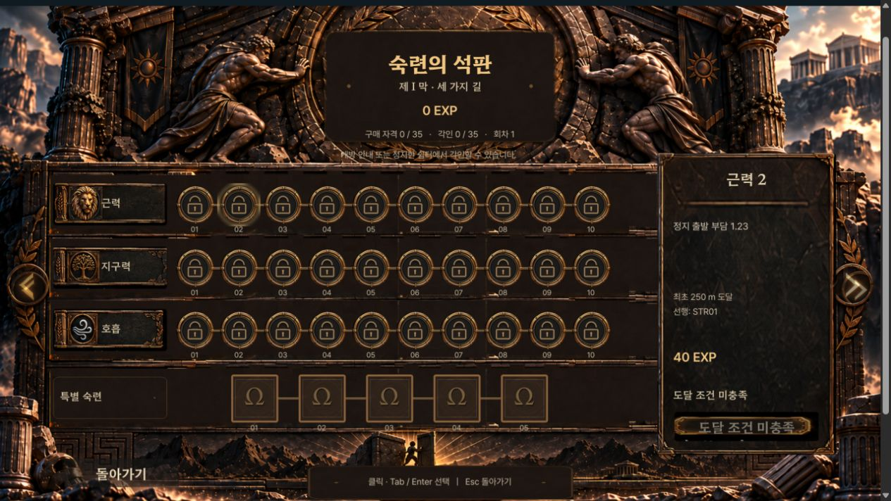
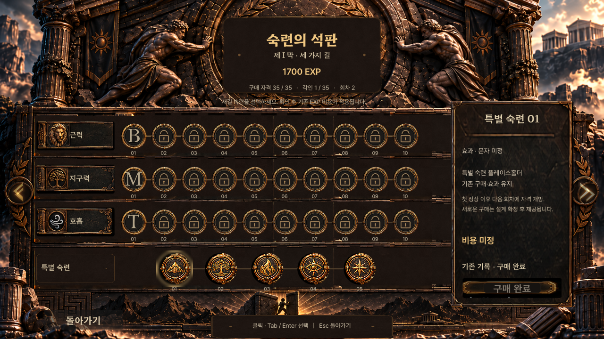

# 에셋 v1.2 패치와 MVP 인게임 석판 연결

사용자가 선택한 **메인화면·프레스티지가 있는 MVP 게임**에 새 석판을 연결했다. 기본 게임의 `main.tscn`과 레벨업 강화점 모델은 변경하지 않는다. 이번 요청은 앞선 독립 프리뷰의 에셋 보존 범위 중 **지정한 11개 PNG 교체와 MVP UI 연결**을 승인한 것으로 적용했다. 새 경제·특별 능력·저장 필드는 추가하지 않았다.

## 에셋

교체 대상은 `character/sisyphus_push_01..05.png`, `character/sisyphus_push_sheet.png`, `special/special_placeholder_01..05.png`다. 패치 바이트를 그대로 사용하고 해상도·이름·경로를 유지했다. 원본 11개는 [originals.zip](originals.zip), 적용 전후는 [비교 화면](comparison.html), 검사와 알파 해석은 [에셋 보고서](asset_patch_report.md)에 보관했다. 나머지 120개는 기존 v1.1 ZIP 해시 그대로다. 상세 결과는 [asset_audit.json](../../../tests/mastery/results/v12-patch/asset_audit.json)을 따른다.

밀기 프레임은 석문을 미는 UI 연출에 사용된다. 등반 중 캐릭터 애니메이션·물리 리소스를 이 석판 전용 파일로 교체한 것은 아니다. 시트와 개별 프레임을 함께 로드하지 않고 기존의 개별 5프레임 재생 경로를 유지했다.

## 실제 게임 연결

- 메인메뉴의 **숙련의 석판**, 등반 중 **Tab**, 일시정지 메뉴, 거리 해금 안내가 공통 새 화면을 연다. 0m에서도 잠긴 노드의 정보를 살펴볼 수 있다.
- **돌아가기 / Esc**로 기존 화면에 복귀한다. 구매 확인창에서 Esc를 누르면 먼저 확인창만 닫힌다. 석판을 보는 동안 등반 진행은 멈춘다.
- 일반 30개는 기존 MVP의 STR/END/BRE 정의·구매 이력·해금 이력을 읽는다. 노드의 명칭·실제 효과·EXP 비용을 그대로 표시한다. 예를 들어 STR01의 기존 정의는 밀기 힘 +3%, 비용 30 EXP다. 독립 프리뷰의 +2%/강화점 모델을 MVP에 적용하지 않는다.
- 실제 구매는 기존 `_confirm_purchase()` 확인창을 거쳐 `_purchase()`와 `mastery.purchase_node()`로 처리한다. 정지한 쉼터/해금 안내 조건과 저장 실패 차단을 유지하며 UI가 직접 지갑을 차감하지 않는다.
- 특별 5개는 미정 플레이스홀더다. 새 특별 구매를 UI에서 차단하며, 이미 저장된 특별 구매와 효과는 삭제·변경하지 않는다. 기존 특별 비용 데이터와 효과 구현도 그대로 남겨둔다.
- 개발 프리뷰의 상태 주입·30점 시연·구매 초기화 버튼은 실제 게임에 표시하지 않는다.
- 새 프로필에서 메뉴 석판을 열고 닫는 것만으로 저장 파일이나 이어하기 기록을 만들지 않는다. 실제 게임 구매·진행 저장은 기존 경로를 유지한다.

MVP는 기존에 누적 랭크 모델과 다른 EXP 지갑/노드/프레스티지 구현을 갖고 있다. 이번 변경은 사용자가 선택한 그 MVP의 현재 규칙을 유지하는 UI 연결이다. 기본 `Progression`의 각 10랭크·총 30점 규칙이나 기존 MVP의 비용 곡선을 새로 설계하지 않았다.

## 변경 범위

| 파일/경로 | 변경 목적 |
|---|---|
| 지정된 `assets/ui/mastery/` PNG 11개 | 사용자 패치 원본으로 교체 |
| `scripts/mastery/mastery_mvp_adapter.gd` | 기존 MVP 상태를 조회하는 어댑터 |
| `scripts/mastery/mastery_mvp_board.gd` 및 공통 씬 | 새 원화·35노드로 실제 MVP 정보를 표시 |
| `scripts/mastery/mastery_screen.gd` | 공통 표시 확장 지점 추가, 기존 모의 프리뷰 유지 |
| `scripts/mvp/mastery_main.gd` | 새 석판 장면 연결·닫기·기존 구매 경로 연결 |
| `scripts/mvp/main_menu.gd` | 0m에서도 조회 메뉴 허용 |
| `export_presets.cfg`의 MVP Web include_filter | CSV 원본을 Web 패키지에 포함 |
| `tests/mastery/results/.gdignore` | 과거 브라우저 캡처를 게임 리소스로 import하지 않도록 제외 |
| `tests/mastery/` 새 검사 및 `results/v12-patch/` | 패치·인게임·회귀·캡처 증거 |

과거 v1.2 프리뷰 검증 결과는 당시 원본을 검증한 기록으로 보존했다. 이제 에셋 11개는 의도적으로 변경되었으므로, 새 패키지는 `audit_patch_assets.py`의 원본+패치 합성 검증을 사용한다. 과거 결과의 131개 전부 원본 해시 유지라는 판정을 현재 패치에 재사용하지 않는다.

## 실행

```powershell
& .tools/godot/Godot_v4.5.1-stable_win64.exe --path . res://scenes/mvp/main_mvp.tscn
python -X utf8 tests/mastery/audit_patch_assets.py
python -X utf8 tests/mvp/build_web.py --output-dir builds/mvp-mastery-patch
```

네이티브 명령은 선택한 MVP 진입점을 명시한다. 기본 게임 진입점 설정은 그대로다. Web export는 `MVP Web` preset을 사용하며 기존 배포 빌드를 덮어쓰지 않는 별도 출력 경로를 사용한다. 구현 검증 당시에는 커밋·푸시·정식 배포를 수행하지 않았다. 이후 사용자가 현재 feature 브랜치 커밋·푸시와 main 머지를 명시적으로 요청했다.

## 최종 검증

| 실제 실행한 검사 | 결과 |
|---|---|
| 패치 원본·해상도·알파·미변경 원본 검사 | 149 PASS |
| 실제 MVP 호스트와 새 석판, 입력·구매·저장 방어 | 918 PASS |
| 기존 성장·저장·UI·통합 회귀 | 898 PASS |
| 기존 독립 프리뷰 데이터 / 상태 / 씬 | 930 / 498 / 20 PASS |
| Godot 4.5.1 프로젝트 import / MVP Web export | 종료 코드 각각 0 |
| 최종 Web 빌드 메뉴 → 석판 → 키보드 선택 → Esc 복귀 → 재진입 | PASS, 관찰 구간 콘솔 오류·경고 0 |

Godot 검사 합계는 **3,264개**이며 에셋 검사는 별도다. [독립 검증 기록](../../../tests/mastery/results/v12-patch/verification/independent_review.json)에 최종 소스·캡처 해시와 검증 한계를 기록했다. 물리·경제·저장 등 보호 대상 핵심 파일 10개는 변경되지 않았다. 특별 노드의 신규 구매는 차단하고 기존 구매 기록과 효과가 보존되는지 검사했다.

네이티브 UI는 실제 MVP 호스트에 격리된 테스트 프로필을 연결하고 실제 InputEvent를 전달하여 1920×1080·1280×720에서 렌더링했다. 모든 35개 노드의 상세 영역과 버튼 폭을 검사했다. 이 캡처는 사용자의 실제 저장 상태가 아니다. [캡처 폴더](../../../tests/mastery/results/v12-patch/verification/captures/)에 메뉴·구매·특별 구매 이력 보존·패치 캐릭터의 석문 밀기 화면 6개가 있다.

최종 웹 빌드는 [로컬 실행](http://127.0.0.1:8773/index.html)에서 확인할 수 있다. 웹 캡처 크기는 1265×712이며 네이티브의 목표 해상도 검증과 구분한다. [브라우저 검사 기록](../../../tests/mastery/results/v12-patch/web/browser-smoke.json), [빌드 파일별 용량·해시](../../../tests/mastery/results/v12-patch/web/build-manifest.json)를 보관했다. 동일 조건의 패치 전 빌드가 없어 용량 증감은 판정하지 않았다.





## 남은 범위

- 구현·검증에서 발견된 차단 이슈는 없다. 특별 노드의 새 문자·효과·구매 정책 확정은 별도 설계가 필요하다.
- Linux 및 다른 브라우저는 실행하지 않았다. 웹 구매·등반 중 Tab 동작은 이번 브라우저 스모크 범위에 포함하지 않았고, 네이티브 실제 호스트 검사에서 확인했다.
- 로컬 웹 서버가 종료되면 실행 링크도 종료된다. 정식 배포는 수행하지 않았다.
- 작업 시작 전부터 존재한 다른 UI 에셋·미추적 작업물은 그대로 두었다. 작업 브랜치는 `feat/mastery-tablet-ui-v12`다.

## Git 반영 범위

이번 변경과 실행에 필요한 기존 미커밋 석판 프리뷰·131개 에셋·매핑 데이터·검증 기록을 함께 반영한다. 다른 MainMenu·sephirot 미추적 작업물과 자동 생성 Python 캐시는 제외한다. main보다 앞선 9개 선행 커밋에는 이미 검증한 MVP·성장·프레스티지·폰트 기반이 있으므로 feature 브랜치 머지에 함께 포함된다.

main의 기존 push 워크플로는 `Web` preset으로 GitHub Pages를 배포한다. 이번 요청에서 그 워크플로나 기본 게임 진입점을 MVP로 바꾸지는 않는다. 따라서 main 머지와 MVP를 정식 웹 기본 진입점으로 전환하는 작업은 구분한다. 최종 커밋·머지 SHA 및 원격 상태는 GitHub 기록과 완료 응답을 따른다.
