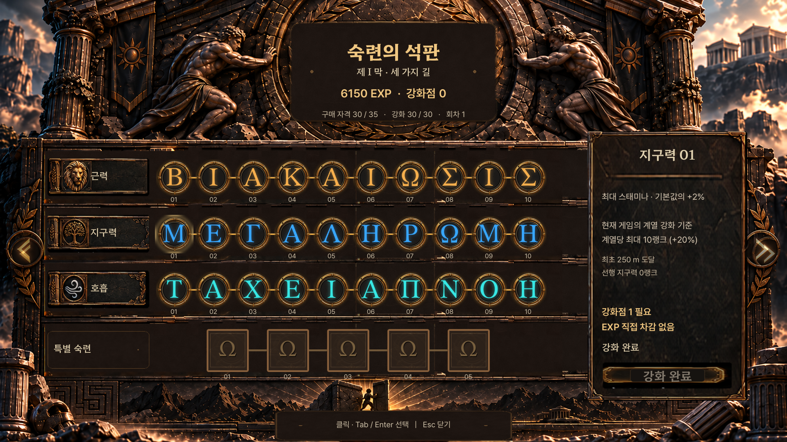

# 숙련의 석판 v1.2 검증

## 실제 실행 범위

| 검사 | 결과 | 증거 |
|---|---|---|
| ZIP / 원본 PNG / CSV / 비문 은행 | 981 PASS | [audit](../../tests/mastery/results/v12/asset_audit.json) |
| Godot 데이터 | 930 PASS | [data](../../tests/mastery/results/v12/verification/data_validation.json) |
| 해금·구매·선행·중복·mock 초기화 상태 | 498 PASS | [state](../../tests/mastery/results/v12/verification/state_tests.json) |
| 기존 v4 저장 / v1 Progression 호환 | 14 PASS | [save](../../tests/mastery/results/v12/verification/save_compatibility.json) |
| Windows OpenGL SubViewport 렌더·실제 InputEvent·배치 | 3,710 PASS | [UI](../../tests/mastery/results/v12/verification/visual_capture.json) |
| 기존 진행 / 저장 견고성 / Web 저장 백엔드 | 50 / 10 / 24 PASS | [회귀](../../tests/mastery/results/v12/regression/report.json) |
| Godot 4.5.1 독립 import / Web debug export | 성공 | [import](../../tests/mastery/results/v12/web/import.txt), [export](../../tests/mastery/results/v12/web/export.txt), [manifest](../../tests/mastery/results/v12/web/build_manifest.json) |
| 실제 Chromium Web UI | 35개 로드 / 6개 상태 / 클릭·키보드 PASS | [브라우저 검수](../../tests/mastery/results/v12/web/browser_review.json), [최종 콘솔](../../tests/mastery/results/v12/web/final-browser-console.json) |

Godot 신규 검사 4종은 5,152개다. 서브뷰포트로 전달한 마우스·Tab·Enter·Esc 이벤트와 실제 렌더를 검증했다. 이를 OS 창 자동화, Linux 실행 또는 브라우저 전체 검증이라고 표현하지 않는다. 기존 Web 호환성 24개는 모의 저장 백엔드 테스트다.

기존 회귀의 잘못된 JSON 입력에 따른 오류 3건, 의도한 저장 실패 경고 1건은 예상된 음성 테스트 진단이며 로그에 보존했다. 예상 밖 오류와 구분한다.

## 실행 명령

```powershell
python -X utf8 tests/mastery/audit_assets.py --zip 'C:\Users\PMS\Downloads\SISYPHUS_mastery_assets_v1_1_GREEK_RESTORED.zip'
& .tools/godot/Godot_v4.5.1-stable_win64_console.exe --headless --path . --editor --import
& .tools/godot/Godot_v4.5.1-stable_win64_console.exe --headless --path . --script res://tests/mastery/mastery_data_validation.gd
& .tools/godot/Godot_v4.5.1-stable_win64_console.exe --headless --path . --script res://tests/mastery/mastery_state_tests.gd
& .tools/godot/Godot_v4.5.1-stable_win64_console.exe --headless --path . --script res://tests/mastery/mastery_save_compatibility.gd
& .tools/godot/Godot_v4.5.1-stable_win64_console.exe --path . --script res://tests/mastery/mastery_visual_capture.gd
python -X utf8 tests/mastery/build_web_preview.py
```

Windows capture는 실제 GL renderer가 필요하며 headless 옵션을 붙이지 않는다. 기존 저장 견고성 테스트에는 반드시 독립 `--save-path`를 지정했다. 원래 테스트 fixture가 존재하면 원본 바이트를 보존·복원했다.

## 캡처

6개 진행 상태를 각각 1920×1080, 1280×720, 960×600으로 렌더링했다. 작은 비16:9 창은 비율을 유지하며 레터박스를 사용한다. 960px에서는 글자가 작아지므로 이 결과를 모바일 가독성 인증으로 확대하지 않는다.

- [0m / 1920](../../tests/mastery/results/v12/verification/captures/zero-1920x1080.png)
- [250m / 1280](../../tests/mastery/results/v12/verification/captures/250-1280x720.png)
- [500m / 1920](../../tests/mastery/results/v12/verification/captures/500-1920x1080.png)
- [750m / 1920](../../tests/mastery/results/v12/verification/captures/750-1920x1080.png)
- [첫 정상 / 1920](../../tests/mastery/results/v12/verification/captures/first_summit-1920x1080.png)
- [다음 회차 / 1280](../../tests/mastery/results/v12/verification/captures/next_run-1280x720.png)
- [다음 회차 / 960×600](../../tests/mastery/results/v12/verification/captures/next_run-960x600.png)
- [일반 30개 구매 완료 / 세 비문](../../tests/mastery/results/v12/verification/captures/all-normal-purchased-1920x1080.png)
- [여러 상태와 선택](../../tests/mastery/results/v12/verification/captures/mixed-states-1920x1080.png)
- [시지프스와 직사각형 석문](../../tests/mastery/results/v12/verification/captures/gate-push-1920x1080.png)



## Web 빌드 실측과 한계

최종 debug export의 파일 크기는 HTML 5,470 bytes, PCK 19,555,396 bytes, WASM 36,145,869 bytes, JS 272,262 bytes다. 별도의 임시 프로젝트를 구성해서 export했으며 기존 프로젝트 설정과 배포 preset을 수정하지 않았다. 원본 소스 SHA는 build_manifest에 기록했다.

최초 export 자체는 성공했지만 실제 브라우저에서는 CSV translation import 때문에 `nodes=0` 오류가 발생했다. [초기 실패 로그](../../tests/mastery/results/v12/web/initial-csv-import-failure.json)를 보존했다. 새 CSV의 keep import와 raw CSV export를 적용한 뒤 최종 실행을 별도로 기록한다. **빌드 성공은 이 초기 런타임 실패를 덮어쓰는 PASS가 아니다.**

최종 in-app Chromium 실행에서 `MASTERY_PREVIEW_READY nodes=35`, 여섯 상태의 `0/10/20/30/30/35` 로그, 일반 강화의 EXP600 유지 및 강화점6→5, 중복 구매 버튼 비활성, 특별01의 비용/효과 미정·구매 불가를 확인했다. Tab/Enter로 선택 변경, Esc 닫기와 상태 버튼 재진입, 연출 건너뛰기를 실제 UI로 조작했다. 최종 실행 구간의 콘솔 error는 0개다. 이 브라우저 캡처는 946×884 뷰포트의 레터박스 화면이며, 1920/1280 검사는 Windows native 캡처와 구분한다.

- [웹 250m](../../tests/mastery/results/v12/web/250-web.png)
- [웹 첫 정상](../../tests/mastery/results/v12/web/first-summit-web.png)
- [웹 다음 회차](../../tests/mastery/results/v12/web/next-run-web.png)
- [웹 강화점 사용·EXP 유지](../../tests/mastery/results/v12/web/normal-purchase-web.png)
- [웹 특별 자격·구매 차단 최종 화면](../../tests/mastery/results/v12/web/final-preview-web.png)

독립 검수 결과는 [검수 JSON](../../tests/mastery/results/v12/verification/independent_review.json)에 있으며, 테스트 소스와 export 소스 해시를 함께 기록했다. 최종 파일 보존과 링크 검증은 [납품 검증](../../tests/mastery/results/v12/delivery_review.json)에 기록한다.

검수 후 외곽 프레임 알파에 대한 잘못된 주석 한 줄만 정정하고 Web을 다시 export했다. 실행 코드는 변경하지 않았으며, 재export된 HTML/PCK/WASM/JS를 포함한 9개 산출물은 브라우저 검증본과 해시가 동일하다(PCK `9acdbd3958cb97d156fda9b40b3ec24cac2927242dae31831ef11b292c02f0ef`). 따라서 앞선 6개 상태·입력 캡처는 최종 배포 파일에도 대응한다. 해당 주석 정정 후 Godot 전체 테스트를 중복 실행했다고 주장하지 않는다.

Firefox·Linux 실기는 미실행이다. GPU/프로세스 메모리, Profiler 메모리 구성, Web 초기 로딩 완료 시간, 안정 상태 FPS는 미측정이다. 실제 2~4막 페이지는 미구현이므로 페이지 전환 성능을 측정했다고 보고하지 않는다.
