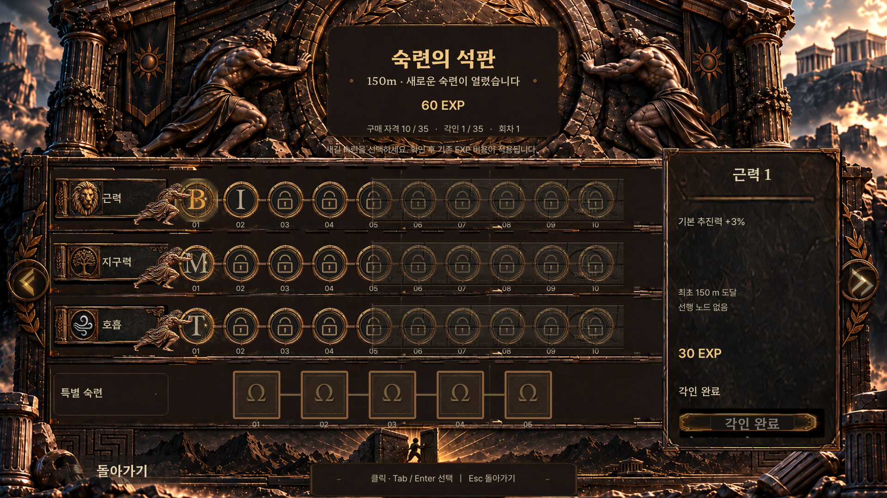

# 숙련의 석판 해금 거리 변경

일반 노드 해금 거리를 **250/500/750m → 150/400/700m**로 변경했다. 각 단계에 10개씩 열리며 700m에서 일반 30개 전체의 구매 자격을 얻는다. 구매는 기존 EXP 비용과 선행 노드 조건을 따른다. 특별 5개의 정상·회차 조건과 미정 상태는 유지했다.

실제 MVP의 판정·해금 연출·노드 상세 안내와 독립 프리뷰의 CSV·상태 버튼·안내를 함께 갱신했다. 원화·그리스어·배치 좌표, EXP 지급식·가격·효과·물리 수치는 바꾸지 않았다. 첫 150m 도달 EXP는 기존 규칙에 따라 90이며, STR01 구매 후 60이 남는다.

기존 저장은 필드를 추가하거나 버전을 바꾸지 않고 읽는다. 이전 250/500/750m 대기 알림과 열린 해금 창은 원래 거리 도달 및 노드 그룹을 검증한 뒤 새 거리로 변환한다. 기존 최고 거리로 새 기준을 충족한 일반 노드는 구매 자격을 보충하며, 로드만으로 새 팝업이나 EXP를 만들지 않는다. 구매 기록·EXP·특별 효과는 유지한다.

## 실제 검증

- 실제 MVP UI: **979개 PASS**, 150m 안내와 90 EXP → 30 EXP 구매 → 60 EXP 잔액, 일시정지·구매 확인·저장·30개 상세 거리 확인. 1920×1080 및 1280×720 렌더링.
- 독립 저장 호환: **158개 PASS**. 149.99/150, 399.99/400, 699.99/700 경계, 이전 저장과 반복 복원·잘못된 이벤트 거절.
- 실제 호스트의 이전 저장 복원: **13개 PASS**. 보존된 250m fixture를 격리 경로에서 이어하기로 열어 150m 안내로 전환되고, 기존 150 EXP와 구매 기회가 유지되며 닫기 후 저장 계약을 통과하는지 확인했다.
- 기존 MVP 및 새 거리 테스트: 성장 114, 저장 109, 계약 167, 호스트 통합 244, 거리 전환 60개 PASS.
- 독립 프리뷰: 데이터 966, 상태 505, 씬 20개 PASS. 상세 캡처·원본 보존 검사는 결과 폴더에 별도 기록.
- MVP Web export 종료 코드 0. 브라우저에서 STR01/STR05/STR08의 150/400/700m 표기 확인, 관찰 구간 콘솔 오류·경고 0. 웹에서는 구매를 실행하지 않았으며 실제 구매는 네이티브 테스트에서 확인했다.

[전체 결과](../../tests/mastery/results/unlock-150-400-700/) · [독립 검토](../../tests/mastery/results/unlock-150-400-700/independent_review.json) · [새 로컬 웹 빌드](http://127.0.0.1:8774/index.html)

과거 결과·기존 웹 fixture는 보존하고 새 결과 경로를 사용했다. 검증 후 사용자 요청에 따라 `feat/mastery-tablet-ui-v12`에 커밋·푸시하며, 이번 후속 변경은 main에 머지하지 않는다. 8774 포트 빌드는 이전 8773과 별도 브라우저 저장 영역을 사용하며 사용자 저장을 옮기거나 초기화하지 않았다.
